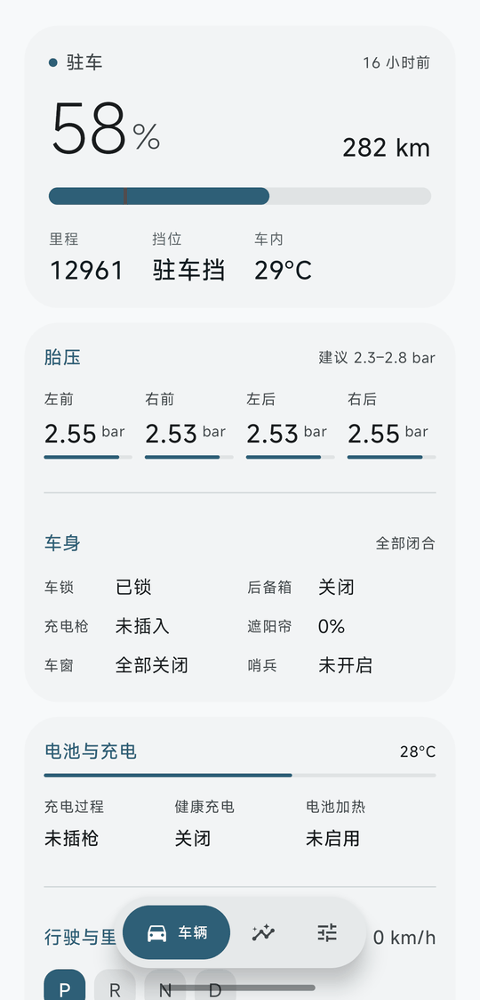
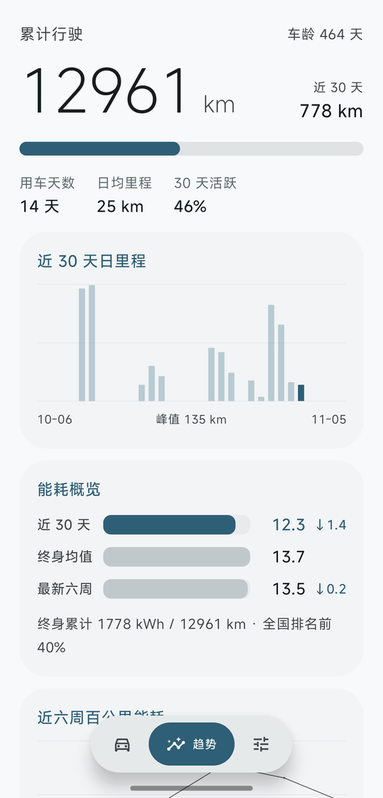
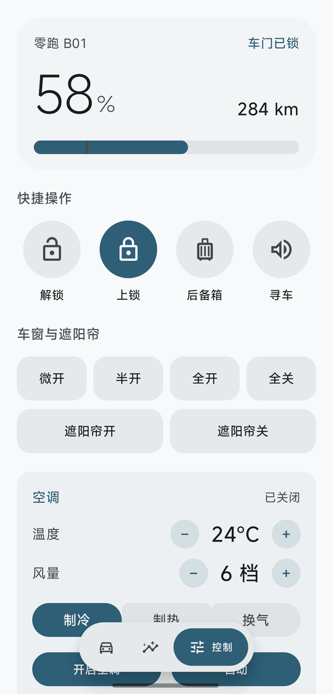
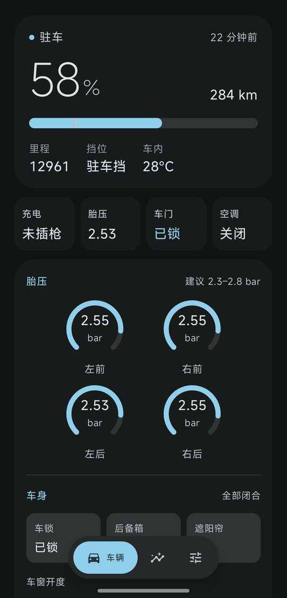
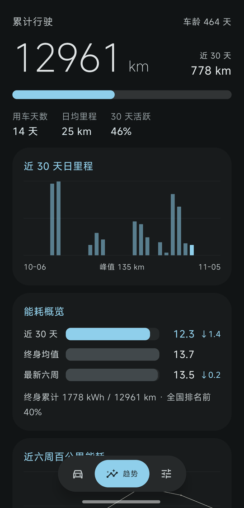
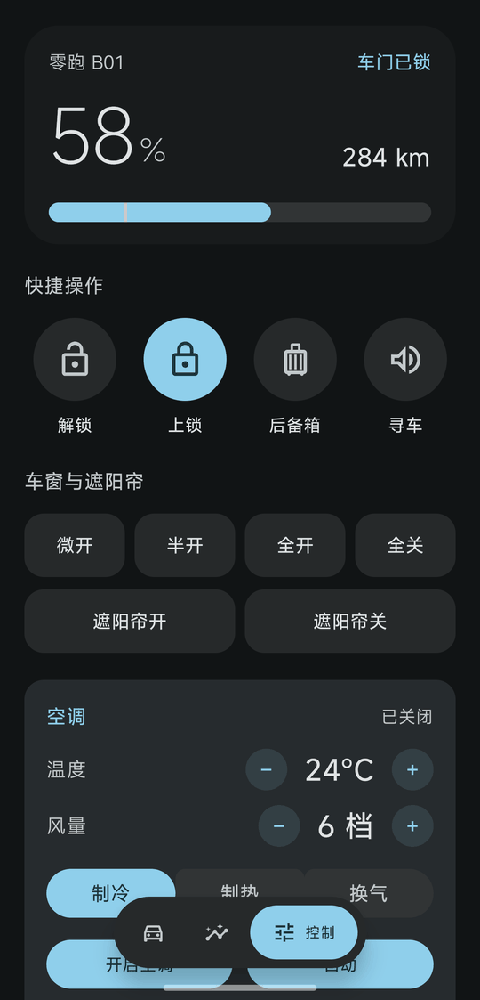

# LeapCo

零跑（Leapmotor）的非官方 Android 客户端。把车端上报的信号全摊开，能耗自己算，凭证只存在手机上。

官方 App 显示的是它筛选过的部分。这个项目直接读车云接口，上百个信号全部可见，续航折扣、能耗走势、每一天跑了多少公里，都能自己看。

**非官方项目，与零跑汽车无任何关联。自己用，别商用。**

## 功能

**车辆状态**
电量、续航（实时 / WLTC / CLTC 三条同刻度对比，并标出车端表显跟的是哪套工况）、四轮胎压、车门与车窗、充电枪、电池温度、座舱温度、车辆位置（可跳高德）、驻车照片。
关键指标没走纯文字列表：胎压是环形仪表（两位小数，低于 2.3 变红），车窗是开度条，电池是环形 SOC。车窗「有没有开」同时看状态位 `1693~1696` 与开度百分比——有的车型只给其中一套，只认一套会导致某些车永远显示关着。

**趋势**
近 30 天逐日里程、近六周百公里能耗、能耗对比条（近 30 天 / 终身均值 / 最新六周）。

**远程控制**
车门解锁上锁、车窗四档（微开 / 半开 / 全开 / 全关）、天窗遮阳帘、后备箱、寻车、哨兵模式。
空调可调温度（16~32°C）、风量（1~7 档）、模式（制冷 / 制热 / 换气）、主副驾座椅加热与通风（0~3 档）、方向盘与后视镜加热。
充电上限（80 / 90 / 100%）、健康充电、电池预热。

**自动刷新**
App 在前台时按车辆状态调整间隔：行驶 6 秒、充电与驻车 30 秒。车控指令下发后会观察目标字段是否真的达成（达成即停，最多 30 秒），不是发完就当成功。

**指令账本**
每一条车控指令都落盘到 `filesDir/command_log.json`：时间、指令号、参数、返回码、耗时，最多保留 60 条。凭证类字段在写入前就被剔除。为什么要这个——车控类工具的可信度取决于用户能否独立验证 App 干了什么，路径直接印在界面上，你自己 `cat` 就能核对。

**充电实时通知**
插枪时自动起一个前台服务，用 **Android 16 的原生实时活动**（Live Updates）在状态栏显示电量和预计充满时间：ColorOS 16+ 渲染成流体云，HyperOS 渲染成超级岛，不认识这套 API 的系统退化成一条普通常驻通知。拔枪即停，不留残影。

用的是标准 API，**不需要任何厂商白名单**：`ProgressStyle` + `setRequestPromotedOngoing`，配上 `POST_PROMOTED_NOTIFICATIONS` 权限。三条硬约束是不满足就静默降级的原因——通知渠道 importance 不能是 MIN、不能自定义 RemoteViews、必须 ongoing。

**提醒**
实时活动只给充电进度用，告警另走两条通道——把告警塞进实时活动会被系统判定滥用，提升请求会被拒，反而连充电也不显示了。

| 提醒 | 触发 | 通道 |
|---|---|---|
| 充电完成 / 充电中断 | 由「充」翻转为「不充」且仍插枪；≥95% 算完成 | 一次性，可划掉 |
| 电量低于 30% / 20% / 10% | 跨档时触发一次；正在充电时不报 | 一次性，20% 以下高优先级 |
| 车门未锁 / 车窗 / 后备箱 | 任一异常，合并成一条；恢复正常自动消失 | 常驻，不响 |
| 胎压报警 | 四轮任一 `tire_alarm_*` 置位，6 小时最多提一次 | 一次性，高优先级 |

低电量按档去重，不然驻车时每 30 秒轮询一次就等于每 30 秒响一声。门锁车窗类提醒需要后台监控，在「控制」页底部开关，默认关——代价是一条常驻通知和少量耗电，这个决定交给用户。插枪时无论开关如何都会启动。

**检查更新**
读 GitHub Releases 比对版本号，间隔可选 6 小时 / 3 天 / 7 天。仓库是私有的，匿名请求返回 404，所以需要在「控制」页底部配一个只读令牌（Keystore 加密存本机，与零跑账号凭证完全隔离）。不配也能用，只是只能手动打开发布页下载。

## 界面

上排浅色、下排深色，从左到右依次是车辆、趋势、控制三页：

<p align="center">
  
  
  
</p>

<p align="center">
  
  
  
</p>

Jetpack Compose，Material 3 Expressive。62sp 细字重主数字、实心比例条（带 20% 低电量阈值线）、连体按钮组、悬浮胶囊导航。宽屏（≥600dp）自动换成左侧导航栏，内容居中限宽。

配色抽成三套，改 `Palette.kt` 里一行 `ActivePalette` 就换，布局一行不动：

| 方案 | 主色 | 观感 |
|---|---|---|
| 深海青 | 冷青 `#15607A` | 工业仪表，最素 |
| 电光青 | 绿青 `#006A66` + 暖橙点缀 | 电子感最强，深色下最亮眼 |
| 琥珀暖 | 琥珀 `#7A5900` + 暖米底 | 像车内饰 |

三套都过 WCAG AA：正文组最低 6.08:1，图形组最低 3.84:1。门禁脚本 `tools/check_contrast.py`，加新配色跑一遍，不达标直接失败。

字体跟随系统，没有内置字体。数字开了 `tnum`（表格数字），刷新时不会左右跳动。

## 编译

需要 JDK 17、Android SDK 36。

```bash
git clone https://github.com/choksta/leapmotor-data.git
cd leapmotor-data
./gradlew assembleDebug
```

产物在 `app/build/outputs/apk/debug/`。release 开了 R8，约 2.4MB。

`local.properties` 里要写自己的 SDK 路径，这个文件已经 gitignore。

## 工作原理

登录走手机号 + 短信验证码，拿到账号 token 后再换车端 JWT。

请求签名链路：

```
签名串  = 六个字段按固定顺序拼接 + 时间戳
签名    = HMAC-SHA256(hkdfKey, 签名串) 的十六进制
hkdfKey = b64url(r2) XOR b64url(r3) XOR b64url(JWT 第三段)
```

车控指令的 `operatePwd` 用 AES 加密，key 由车端 JWT 派生（不能用账号 token）。

凭证存 `session.bin`，用 Android Keystore 的 AES-256-GCM 加密，密钥驻留在 TEE 内不可导出。车控 PIN 同样是密文。

车端 JWT 有效期约 2 小时。代码会在剩余不足 10 分钟时免密续期；如果服务端仍判定过期（时钟偏差、令牌被吊销），会自动强制续期后重试一次，不把用户踢回登录页。

## 已知限制

- **App 不在前台就不刷新。** 这是纯客户端方案的固有限制。没有做前台服务常驻——耗电，而且系统会杀。
- **部分信号仍未破解。** 公开信号表有错（比如被标成车窗开度的其实是二排座椅通风），要靠逐台车实测校正，没有猜着填。App 里单独折叠成一块，标明是原始值，不硬套语义。
- **3D 车模没做成。** 素材能下载，但 WebView 里视口高度拿不到，模型实例化后画布不渲染。已放弃，用图形化卡片代替。
- **依赖 `material3:1.5.0-alpha06`。** Expressive 的 API 在 1.4.0 里还是 internal。alpha 版本踩过几个坑，稳定性有取舍。
- 仅实测过零跑 B01 2025 款（650 激光雷达版）。其他车型信号号可能不同。

## 免责声明

项目通过逆向官方 App 的接口实现，接口随时可能变，也不保证符合零跑的服务条款。仅供个人学习与自用。

使用风险自负。远程控制涉及真实车辆动作（开窗、开后备箱、解锁），请确认车在视线范围内再操作。作者不对任何车辆损失或账号问题负责。

## 更新日志

见 [CHANGELOG.md](CHANGELOG.md)。

## 许可

MIT
